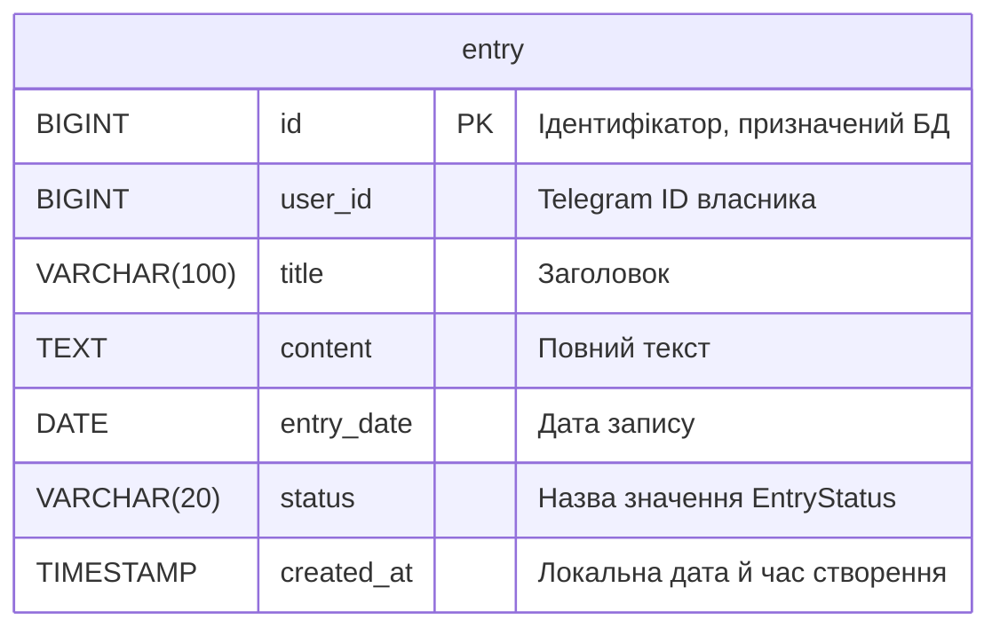
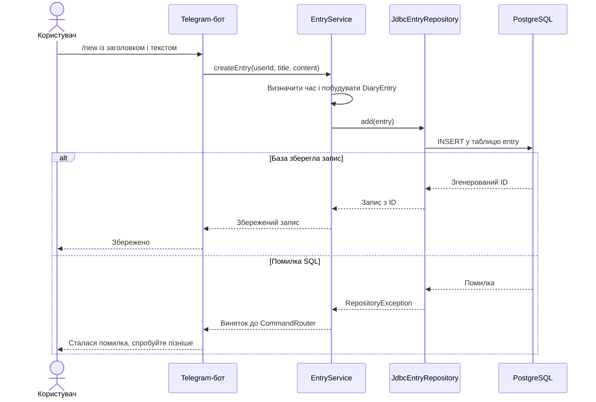

# SDD — Система ведення щоденника

## 1. Призначення та межі MVP

Користувач веде особистий щоденник у приватному чаті Telegram. Одним повідомленням він додає запис із заголовком і текстом, а командою `/list` переглядає останні записи. Власника визначає Telegram ID відправника. Дані зберігаються в PostgreSQL через JDBC.

Цей документ описує MVP із трьома командами. Для фінальної версії теми №21 передбачено експорт вибраних записів у PDF або текстовий файл. Це наступний етап проєкту.

## 2. Функціональні вимоги

| ID | Поведінка |
|---|---|
| FR-1 | Бот обробляє текстові повідомлення з приватного чату, якщо відомий відправник. Повідомлення з груп пропускаються до маршрутизації команд. |
| FR-2 | На `/start` бот надсилає привітання й пояснює, як створити та переглянути записи. На невідому команду пропонує звернутися до `/start`. |
| FR-3 | Команда `/new` приймає заголовок і текст в одному повідомленні. Перший перенос рядка після заголовка відділяє вміст запису. Внутрішні переноси вмісту зберігаються. |
| FR-4 | Бот приймає заголовок завдовжки до 100 одиниць UTF-16 включно. Заголовок і вміст повинні містити хоча б один непробільний символ. За помилки формату чи валідації користувач отримує пояснення. |
| FR-5 | Сервіс присвоює запису ID власника, дату та час створення. Новий запис має статус `SAVED`. Після успішного збереження бот відповідає «Збережено». |
| FR-6 | На `/list` бот показує до п’яти власних записів за спаданням дати, а в межах однієї дати — за спаданням ID. Для порожнього щоденника відповідь — «Записів ще немає». |
| FR-7 | Для кожного запису у списку бот показує номер, дату у форматі `dd.MM.uuuu`, заголовок і початок тексту. Переноси у попередньому перегляді замінюються пробілами. Якщо текст довший за 100 одиниць UTF-16, після перших 100 додається «…». |

## 3. Нефункціональні вимоги

| ID | Вимірюваний критерій | Перевірка |
|---|---|---|
| NFR-1. Приватність | Для двох різних користувачів кількість чужих записів у результатах пошуку за ID та перегляду списку дорівнює 0. | Створити записи для двох власників. Перевірити склад кожного списку та запит чужого ID через репозиторій. |
| NFR-2. Цілісність тексту | Після запису в БД і повторного читання кількість змінених або втрачених символів у збереженому заголовку й вмісті дорівнює 0. | Порівняти рядки до та після читання через JDBC, включно з українськими літерами, лапками й переносами. |
| NFR-3. Відтворюваність збірки | На Java 21 команда `mvn clean package` завершується з кодом 0, а кількість помилок і падінь тестів JUnit 5 дорівнює 0. | Запустити чисту збірку. Для JDBC-тестів використовується H2, для тестів команд — тестові заміни залежностей. |

## 4. Архітектура та відповідальність класів

| Компонент | Відповідальність |
|---|---|
| `Main` | Читає `BOT_TOKEN`, створює залежності, реєструє три команди й запускає отримання оновлень Telegram через long polling. |
| `DiaryBot`, `IncomingMessage`, `CommandRouter` | Перевіряють тип чату, виділяють команду й аргументи, знаходять обробник за назвою. Для передачі даних усередині застосунку достатньо ID користувача, ID чату й тексту. |
| `StartCommand`, `NewEntryCommand`, `ListCommand` | Виконують сценарії користувача. `EntryFormatter` готує текст для перегляду списку. |
| `EntryService`, `DiaryEntry`, `EntryStatus` | Сервіс отримує поточний час через `Clock` і передає запис репозиторію. Побудовник перевіряє обов’язкові поля та створює об’єкт запису. |
| `EntryRepository`, `JdbcEntryRepository`, `DatabaseConnection` | Відкривають JDBC-з’єднання, зберігають запис і читають записи власника за допомогою параметризованих SQL-запитів. |
| `MessageGateway`, `TelegramMessageGateway` | Відокремлюють команди від Telegram SDK. Адаптер надсилає відповіді в чат, із якого отримано команду. |

**Builder — породжувальний патерн.** У запису сім полів, зокрема дві дати різного призначення. `DiaryEntry.Builder` дозволяє назвати кожне поле й перевірити їх разом у `build()`. Без побудовника сервісу й репозиторію довелося б узгоджувати порядок параметрів довгого конструктора.

**Adapter — структурний патерн.** Командам потрібен спосіб відповісти користувачу без залежності від типів Telegram SDK. `TelegramMessageGateway` реалізує `MessageGateway` і перетворює виклик надсилання на запит до `TelegramClient`. Без адаптера команди самі формували б запити Telegram, що ускладнило б їх ізольоване тестування.

**Command — поведінковий патерн.** Створення запису, перегляд списку й привітання мають різні правила обробки. Кожна дія реалізує `BotCommand`, а `CommandRouter` знаходить її за назвою та викликає `execute()`. Без поділу на команди додавання нової дії вимагало б змінювати спільний обробник із розгалуженнями.

## 5. Модель даних

У PostgreSQL є одна таблиця `entry`. Поле `user_id` містить зовнішній ідентифікатор Telegram. Один власник може мати багато записів. Для пошуку за власником схема створює індекс `idx_entry_user_id`.



Усі поля обов’язкові. Сервіс бере `entry_date` і `created_at` з одного показу годинника в часовому поясі застосунку. Модель передбачає `DRAFT`, `SAVED` і `ARCHIVED`. Команда `/new` створює запис зі статусом `SAVED`. Для списку репозиторій сортує всі записи користувача, після чого `ListCommand` відбирає перші п’ять.

## 6. Основний сценарій і Definition of Done

**Приклад одного повідомлення в приватному чаті**

```text
/new Перша репетиція
Сьогодні записав гітарну партію.
```



**Definition of Done для FR-5.** Вимогу можна прийняти, коли виконано всі перевірки:

- Після одного коректного `/new` кількість записів власника збільшується на один. Репозиторій повертає призначений БД ID.
- Повторне читання за цим ID і власником повертає передані заголовок і повний текст, очікувану дату та статус `SAVED`. Запит з ID іншого власника повертає порожній результат.
- Бот надсилає «Збережено» після успішного запису. За помилки БД користувач отримує повідомлення про збій.
- У тестовому сценарії «створити → переглянути» новий запис з’являється у відповіді на `/list`. Порожній текст або заголовок довжиною 101 одиниця UTF-16 не збільшує кількість записів.

## 7. Запуск і ризики

Застосунок потребує Java 21, Maven, токена Telegram у змінній середовища `BOT_TOKEN` та PostgreSQL. Перед першим запуском слід виконати `src/main/resources/schema.sql` саме в базі, зазначеній у `db.url`. Параметри `db.url`, `db.username` і `db.password` читаються з диска. Типовий шлях від кореня проєкту — `src/main/resources/database.properties`. Для іншої робочої директорії шлях задається через `-Ddiary.db.config=...`. Точка входу — `com.diary.Main`.

| Ризик | Як виявити або зменшити |
|---|---|
| Бот відповідає на `/start`, але таблиця відсутня | Підготувати схему до запуску. Перевіряти готовність наскрізним сценарієм `/new` → `/list`, оскільки привітання не звертається до БД. |
| Запис може потрапити в груповий чат або до чужого списку | Перевіряти приватний тип чату до маршрутизації та фільтрувати читання за `user_id`. Перевіряти обидві межі окремо. |
| Облікові дані потраплять до репозиторію чи JAR | Зберігати токен у середовищі, а локальний файл із паролем виключати з Git і Maven-ресурсів. |
| БД зберегла запис, але Telegram не доставив підтвердження | Повторна команда може створити дублікат. Після збою доставки перевірити останні записи через `/list` перед повторним введенням. |

