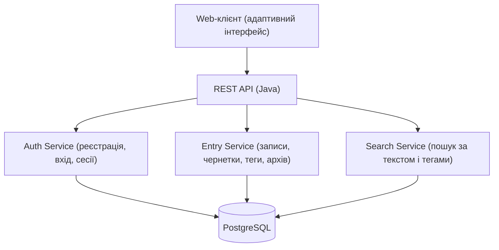
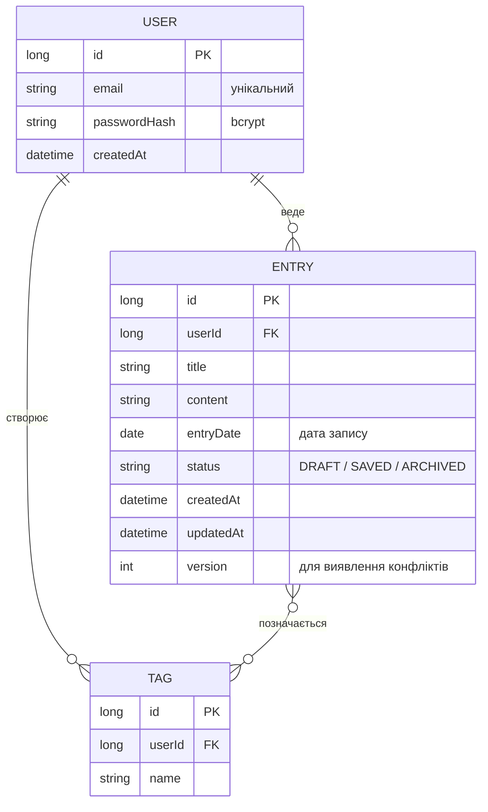
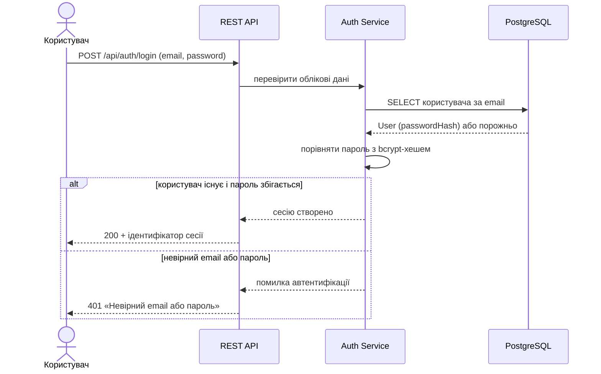
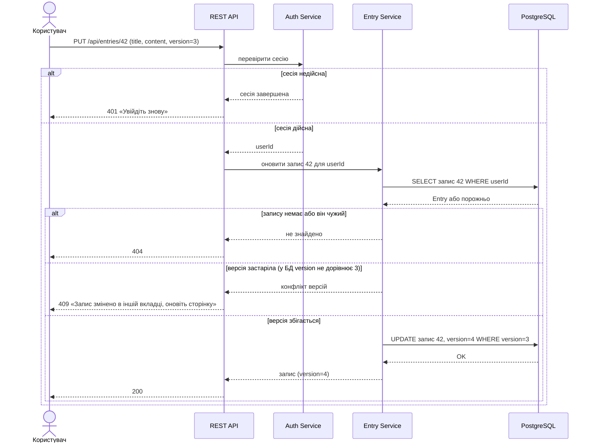
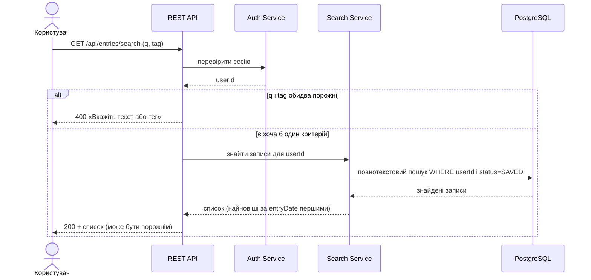

# SDD: Система ведення щоденника

## 1. Огляд і глосарій

Система — Консольний застосунок для ведення особистого щоденника. Користувач створює записи
за датами, редагує їх, позначає тегами, шукає за текстом і тегами та переглядає записи
в хронологічному порядку. Записи приватні: доступні лише їхньому власнику. Перша версія
обслуговує окремих користувачів: кожен користувач має свій ізольований щоденник,
спільного або публічного доступу до записів немає.

**Поза скоупом першої версії:** спільний і публічний доступ до записів; мобільні
застосунки (лише адаптивний веб); вкладення (зображення, файли); імпорт та експорт
записів.

**Глосарій:**

| Термін | Значення в цьому документі |
|--------|----------------------------|
| Користувач | Зареєстрована особа, яка веде щоденник. Автентифікується в системі й має доступ лише до власних даних. |
| Щоденник | Сукупність усіх записів одного користувача. Щоденник — логічна сутність: окремої таблиці в БД немає, він виводиться як множина записів, що належать користувачеві. |
| Запис | Текстовий запис щоденника: запис у БД із заголовком, текстом, датою запису, статусом (`DRAFT`, `SAVED`, `ARCHIVED`) і посиланням на користувача. |
| Дата запису | Календарна дата, до якої належить запис. Задається користувачем (типово — поточна) і відрізняється від технічних міток створення та зміни. |
| Чернетка | Запис зі статусом `DRAFT`: ще не збережений остаточно, не потрапляє в пошук і хронологічний перегляд. |
| Тег | Коротка текстова мітка, яку користувач додає до запису для групування й пошуку. Один запис може мати кілька тегів. |

## 2. Функціональні вимоги

| ID | User story | Пріоритет |
|----|------------|-----------|
| US-1 | Як відвідувач, я хочу зареєструватися та увійти в систему, щоб мати власний приватний щоденник, недоступний іншим. | Must |
| US-2 | Як користувач, я хочу створити запис із заголовком, текстом і датою, щоб зафіксувати події та думки конкретного дня. | Must |
| US-3 | Як користувач, я хочу переглядати свої записи в хронологічному порядку, щоб повертатися до минулих днів без пошуку вручну. | Must |
| US-4 | Як користувач, я хочу редагувати збережений запис, щоб виправляти помилки й доповнювати його пізніше. | Must |
| US-5 | Як користувач, я хочу зберегти запис як чернетку, щоб дописати його пізніше, не публікуючи незавершений текст у хронології. | Should |
| US-6 | Як користувач, я хочу додавати теги до запису, щоб групувати записи за темами. | Should |
| US-7 | Як користувач, я хочу шукати записи за текстом і тегами, щоб швидко знаходити потрібну подію. | Should |
| US-8 | Як користувач, я хочу архівувати запис, щоб прибрати його з основного перегляду, але не втратити. | Should |
| US-9 | Як користувач, я хочу переглядати записи в календарному вигляді, щоб бачити, за які дні я вів щоденник. | Could |
| US-10 | Як користувач, я хочу поділитися записом з іншою людиною, щоб показати їй вибрані думки. | Won't (this time) |
| US-11 | Як користувач, я хочу прикріплювати до запису зображення та файли, щоб доповнити його фото й документами. | Won't (this time) |

## 3. Нефункціональні вимоги

| ID | Категорія | Вимога (з метрикою) |
|----|-----------|---------------------|
| NFR-1 | Продуктивність | Відкриття списку записів (сторінка з 20 записів) — < 300 мс (p95); пошук за текстом і тегами — < 500 мс (p95) при навантаженні та обсязі даних з NFR-2. |
| NFR-2 | Масштаб | Система витримує 100 одночасних користувачів без деградації понад NFR-1; до 1000 користувачів і 200 000 записів у БД. |
| NFR-3 | Доступність | Uptime ≥ 99% на місяць (≈ до 7.2 години простою); планові роботи — вночі за Києвом. |
| NFR-4 | Безпека | Паролі зберігаються лише у вигляді хешу (bcrypt); увесь трафік — HTTPS; сесія автоматично завершується після 30 хвилин неактивності. |
| NFR-5 | Приватність | Жоден запит користувача не повертає й не змінює чужі записи: автотест для кожного ендпоінта підтверджує, що спроба доступу до запису іншого користувача завершується відповіддю 403 або 404. |
| NFR-6 | Цілісність | Збереження запису атомарне: при збої не лишається частково збереженого запису. Одночасне редагування одного запису з двох вкладок не перезаписує зміни мовчки (перевіряється тестом на 2 паралельні оновлення: друге отримує помилку конфлікту). |
| NFR-7 | Надійність даних | Щоденний бекап БД зі зберіганням 30 днів; відновлення з бекапу ≤ 1 години (перевіряється щоквартальною навчальною тривогою). |
| NFR-8 | Сумісність | Інтерфейс коректно відображається на екранах від 360 px завширшки в двох останніх версіях Chrome, Firefox, Edge і Safari. |

## 4. Архітектура

**Компоненти:**

- **Web-клієнт** — адаптивний вебінтерфейс: форми входу й запису, хронологічний і календарний перегляд, пошук; працює з системою лише через REST API.
- **REST API** — єдина точка входу: приймає запити клієнта, перевіряє сесію, валідує вхідні дані й передає запит відповідному сервісу.
- **Auth Service** — реєструє користувачів, перевіряє паролі (bcrypt), створює й завершує сесії.
- **Entry Service** — створює, редагує й архівує записи, керує статусами `DRAFT`, `SAVED`, `ARCHIVED` і тегами, гарантує, що користувач працює лише з власними записами.
- **Search Service** — шукає серед збережених записів користувача за текстом і тегами, не повертаючи чернетки.
- **PostgreSQL** — єдине сховище даних: користувачі, записи й теги; зовнішніх сервісів система не використовує.

## 5. Модель даних

Щоденник як окрема сутність не зберігається: він виводиться як множина `ENTRY` одного `USER`, тому
ізоляція даних (NFR-5) забезпечується умовою `userId` у кожному запиті. Теги належать користувачеві, а не є
спільними, із унікальністю `(userId, name)`; зв'язок `ENTRY }o--o{ TAG` у БД реалізується проміжною
таблицею `entry_tag`. Поле `version` дає змогу виявити одночасне редагування одного запису з двох вкладок
(NFR-6), а `entryDate` відокремлена від `createdAt`, бо користувач може вести запис за інший день.

## 6. Ключові сценарії

### 6.1. Вхід у систему

Користувач входить у свій щоденник; без успішного входу жоден запис недоступний.

Повідомлення про помилку однакове для неіснуючого email і невірного пароля, щоб не розкривати,
які адреси зареєстровані. Сесія завершується після 30 хвилин неактивності (NFR-4).

### 6.2. Редагування запису з виявленням конфлікту

Користувач зберігає зміни запису, який відкритий у двох вкладках; перше збереження проходить,
друге не має мовчки перезаписати його (NFR-6).

Чужий запис повертає 404, а не 403, щоб не підтверджувати його існування (NFR-5).

### 6.3. Пошук записів

Користувач шукає подію за текстом і/або тегом; пошук охоплює лише його збережені записи.

Чернетки (`DRAFT`) та архівовані записи (`ARCHIVED`) у результатах не з'являються.
Перевірка сесії тут виконується так само, як у 6.2.

## 7. Ескіз API

| Метод | Шлях | Призначення | Доступ |
|-------|------|-------------|--------|
| POST | `/api/auth/register` | Реєстрація нового користувача (US-1) | публічний |
| POST | `/api/auth/login` | Вхід, створення сесії (US-1, сценарій 6.1) | публічний |
| POST | `/api/auth/logout` | Завершення сесії | користувач |
| POST | `/api/entries` | Створити запис зі статусом `SAVED` або `DRAFT` і тегами (US-2, US-5, US-6) | користувач |
| GET | `/api/entries?from=2026-10-01&to=2026-10-31&status=SAVED&page=1` | Хронологічний список власних записів; `status` типово `SAVED`, значення `DRAFT` і `ARCHIVED` відкривають чернетки й архів (US-3, US-5, US-8) | користувач |
| GET | `/api/entries/{id}` | Один власний запис | користувач |
| PUT | `/api/entries/{id}` | Редагувати запис; у тілі обов'язкова `version`, при застарілій — 409 (US-4, сценарій 6.2) | користувач |
| POST | `/api/entries/{id}/archive` | Архівувати запис (US-8) | користувач |
| GET | `/api/entries/search?q=...&tag=...` | Пошук серед збережених записів за текстом і тегом (US-7, сценарій 6.3) | користувач |
| GET | `/api/tags` | Список тегів користувача для підказок і фільтрів (US-6) | користувач |
| GET | `/api/entries/calendar?month=2026-10` | Дні місяця, за які є записи (US-9) | користувач |

## 8. Ризики та альтернативи

**Ризики:**

| Ризик | Імовірність | Вплив | Як пом'якшуємо |
|-------|-------------|-------|----------------|
| Користувач бачить або змінює чужі записи через помилку в перевірці власника | низька | Критичний: щоденник містить приватні думки, витік руйнує довіру до продукту | Умова `userId` у кожному запиті до БД; автотест на кожен ендпоінт із доступом до чужого запису (NFR-5); чужий запис повертає 404. |
| Втрата записів через збій БД або помилку при оновленні | низька | Високий: записи часто неможливо відновити з пам'яті | Щоденний бекап зі зберіганням 30 днів і відновленням до 1 години (NFR-7); атомарне збереження запису (NFR-6). |
| Зміни перезаписуються при редагуванні одного запису з двох вкладок | середня | Середній: втрачений текст, роздратування користувача | Поле `version` і відповідь 409 при застарілій версії; конкурентний тест на 2 паралельні оновлення (NFR-6). |
| Пошук сповільнюється зі зростанням кількості записів | середня | Середній: порушення NFR-1, незручність щоденного використання | Повнотекстовий індекс у PostgreSQL по `title` і `content`; навантажувальний тест на 200 000 записів (NFR-2). |
| Злам акаунта через слабкий пароль або підбір | середня | Високий: доступ до всіх записів користувача | Паролі лише як bcrypt-хеш, HTTPS (NFR-4); мінімальна довжина пароля; обмеження кількості невдалих спроб входу. |
| Розростання скоупу (спільний доступ, вкладення, експорт) затягує перший реліз | середня | Середній: Must-історії не завершені вчасно | Дотримуватися пріоритетів MoSCoW із розділу 2; Won't-історії не беруться в роботу до завершення Must і Should. |

**Розглянуті альтернативи:**

- **Зберігати записи локально (файли або сховище браузера) замість серверної БД:** відкинуто —
  це простіше й приватніше, але записи прив'язані до одного пристрою, немає бекапів на боці
  системи й неможливо працювати з кількох пристроїв.
- **Зовнішній пошуковий рушій (Elasticsearch) замість повнотекстового пошуку PostgreSQL:**
  відкинуто — на масштабі 200 000 записів вбудований повнотекстовий індекс достатній для
  NFR-1, а окремий сервіс додав би інфраструктуру й проблему синхронізації з БД; Search Service
  лишається окремим модулем, тож заміну можна зробити пізніше.
- **Мікросервіси (Auth, Entry, Search окремими процесами) замість модульного моноліту:**
  відкинуто для першої версії — масштаб малий, а три модулі зі спільною БД дають ті самі межі
  відповідальності без мережевих викликів і розподілених транзакцій.
- **Пессимістичне блокування запису на час редагування замість поля `version`:** відкинуто —
  вкладка може лишитися відкритою годинами й тримати блокування; оптимістична перевірка версії
  не блокує нікого й виявляє конфлікт лише тоді, коли він справді стався.
- **Теги як рядок у полі запису замість окремої таблиці:** відкинуто — ускладнює пошук за тегом,
  підказки з `GET /api/tags` і гарантію унікальності `(userId, name)`.
